<p align="center">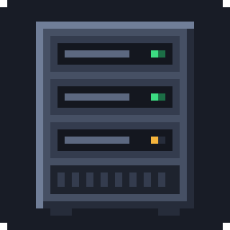</p>

<h1 align="center">Serverworks</h1>

<p align="center"><b>Build a server rack in Minecraft, load it with mods and plugins from Modrinth,<br>
switch it on, and walk into the real server it runs.</b><br>
A Fabric mod for Minecraft 26.3 · every major server platform · all art generated by script</p>

<!-- badges:start -->
<p align="center">
<a href="https://github.com/Atomiceatscode/serverworks/actions/workflows/ci.yml"></a>


<a href="https://github.com/Atomiceatscode/serverworks/blob/main/LICENSE"></a>
</p>
<p align="center">


</p>
<p align="center">


</p>
<p align="center">


</p>
<p align="center">


</p>
<!-- badges:end -->

<p align="center">
<a href="#what-it-does">What it does</a> ·
<a href="#install">Install</a> ·
<a href="#quick-start">Quick start</a> ·
<a href="#recipes">Recipes</a> ·
<a href="#how-it-was-made">How it was made</a> ·
<a href="#stats">Stats</a> ·
<a href="#building-and-testing">Building</a>
</p>

| | |
|---|---|
| 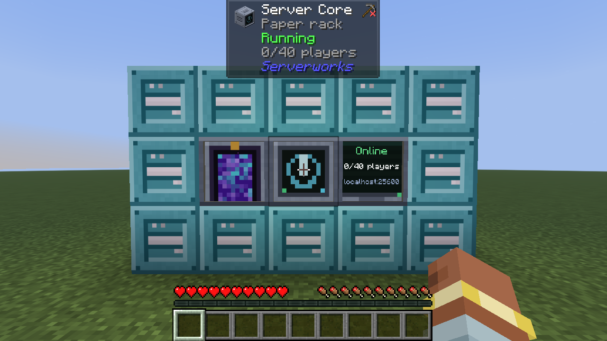 | 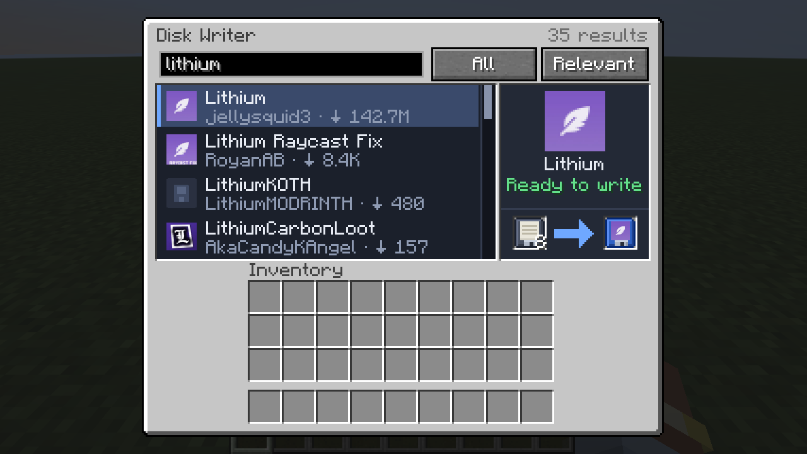 |
| 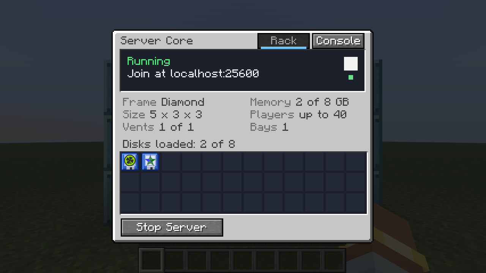 | 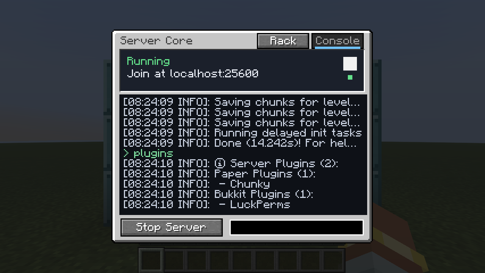 |
| 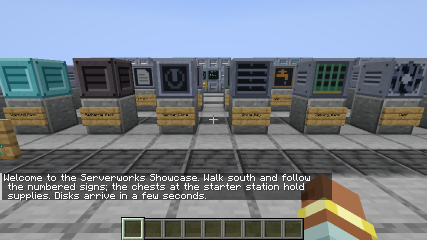 | 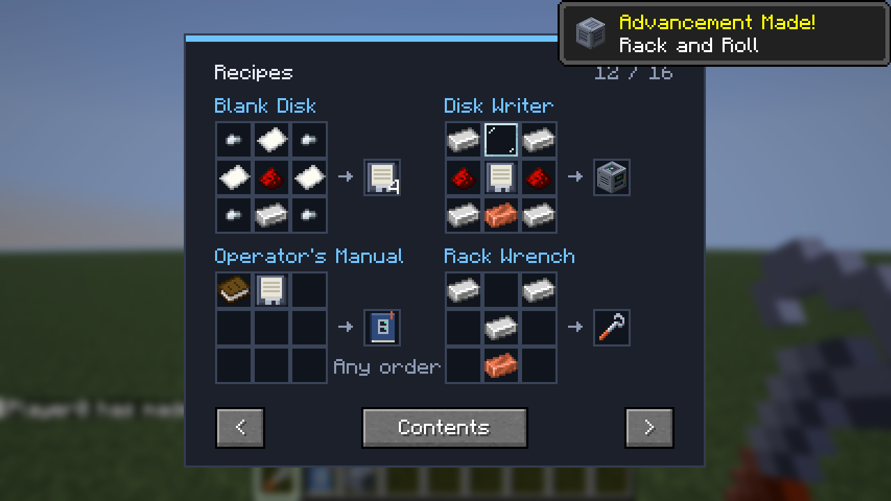 |

Powered by the [Modrinth API](https://docs.modrinth.com/). Serverworks is not affiliated
with or endorsed by Modrinth.

## What it does

- **Disks from the catalog.** The Disk Writer searches Modrinth in game; type `@name`, or
  click an author's name, to list everything one author made. Star projects to keep them
  as favourites, or list a Modrinth collection with `collection:ID`. Click a project, or
  drag it onto the right-hand panel, and write it onto a Blank Disk; the disk takes the
  project's name and icon. Pin a disk to one version, or let it take the newest. Modpacks
  become Pack Cartridges.
- **Racks you build.** A hollow box of Rack Casing, 3 to 7 blocks a side, with a Server
  Core, a Platform Module, Drive Bays, Memory Banks and Vents. Iron, diamond and netherite
  casings set the memory and player limits. The Rack Wrench outlines anything missing.
- **Real servers.** Starting a rack downloads the server software and the newest version
  of each disk's project that suits it, checks every file's hash, and runs the server on
  your computer. The Server Core shows progress, the address and a live console, and
  flags disks with newer versions to update in one click. Several racks can run at once
  (6 by default).
- **Configure with items.** A Config Card sets difficulty, game mode, PvP, keep inventory
  and more. A World Drive gives a rack its own world: a seed, a world type, or a copy of
  one of your singleplayer worlds. Swap drives to switch worlds.
- **Backups.** Back a rack's world up from the Server Core, even while it runs, restore
  any copy, or turn on automatic backups.
- **Redstone.** A comparator reads how full a rack's server is, and a redstone signal can
  start and stop it.
- **Walk in.** Use the Gateway and the game saves your world and joins the rack's server.
  Press B (or "Return to …" in the pause menu) to go back. On a dedicated server players
  travel through the server's own port, so racks need no ports opened. Status Displays
  show who is on, with their heads, and the server's memory and uptime.
- **Every major platform.** Vanilla, Paper, Purpur, Folia, Spigot, CraftBukkit, Sponge,
  Fabric, Quilt, NeoForge and Forge servers; Velocity and BungeeCord proxies in front of
  other racks, linked with Link Cards.
- **Feels like a machine.** Fans spin, lights blink, the rack hums, chimes when it comes
  up and sounds an alarm if it crashes. The Operator's Manual explains everything and
  draws every crafting grid, and an advancement tab runs from your first disk to a
  netherite rack.
- **A guided tour.** Turn on "Serverworks Showcase" on the Create World screen for a
  creative world with every block laid out and four example racks ready to start.

| | |
|---|---|
| 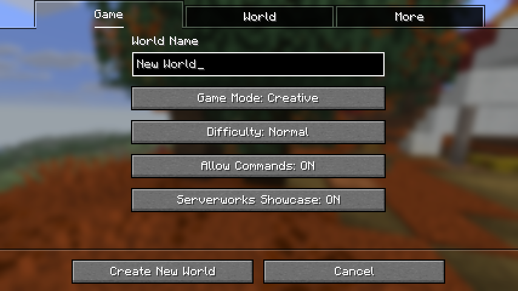 | 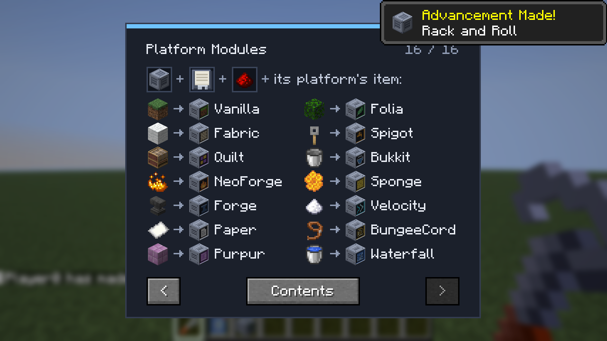 |
| 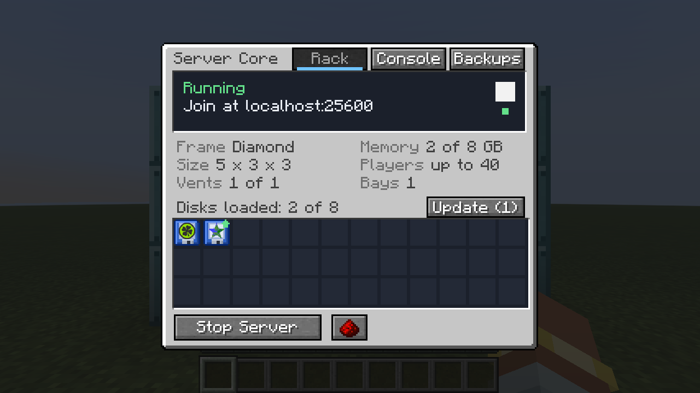 | 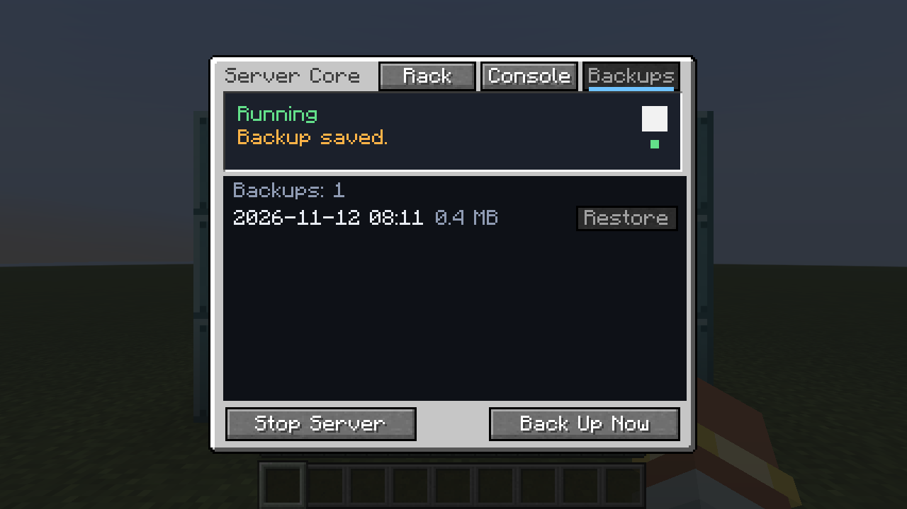 |

## Requirements

- Minecraft 26.3, Fabric Loader 0.20.1 or newer, Fabric API.
- Java 25 (what Minecraft 26.3 itself needs). Rack servers reuse the game's Java.
- An internet connection, and memory for the servers you run: each uses its rack's
  memory (1 to 16 GB) on top of the game's.
- `git`, only for Spigot and CraftBukkit racks (they are compiled the first time).
- Optional: [Mod Menu](https://modrinth.com/mod/modmenu) for a settings screen,
  [Jade](https://modrinth.com/mod/jade) for rack details when looking at rack blocks,
  [JEI](https://modrinth.com/mod/jei) or [REI](https://modrinth.com/mod/rei) for recipes
  and information pages.

## Install

1. Install [Fabric Loader](https://fabricmc.net/use/) 0.20.1 or newer for Minecraft 26.3.
2. Download `serverworks-1.1.0.jar` from [Releases](https://github.com/Atomiceatscode/serverworks/releases)
   and put it in your `mods` folder, with [Fabric API](https://modrinth.com/mod/fabric-api) for 26.3.
3. Start the game. To look around first, create a world with **Serverworks Showcase** on.

## Quick start

1. Craft Blank Disks (iron, paper, redstone) and a Disk Writer. The Operator's Manual is a
   book plus a Blank Disk.
2. Write some disks in the Disk Writer: search (`@name` finds one author's projects), click
   a project (or drag it onto the right-hand panel), take the disk.
3. Build a 3 x 3 x 3 box of Iron Rack Casing. Swap face centres for a Server Core, a
   Platform Module, a Drive Bay, a Memory Bank and a Vent; leave the middle empty. The
   sixth face centre takes a Gateway. For more room, make the rack longer.
4. Put your disks in the Drive Bay, open the Server Core and press Start. Agree to the
   Minecraft EULA the first time.
5. When it says Running, use the Gateway. Press B to come back.

## Recipes

All recipes are also drawn in game on the Operator's Manual's Recipes pages. Grids read
top row / middle row / bottom row.

| Item | Recipe |
|---|---|
| Blank Disk ×4 | Iron nuggets in the corners, paper on the sides, redstone in the centre; bottom middle is an iron ingot |
| Disk Writer | `I G I` / `r B r` / `I C I` (I iron ingot, G glass pane, r redstone, B Blank Disk, C copper ingot) |
| Operator's Manual | Book + Blank Disk (any order) |
| Rack Wrench | `I _ I` / `_ I _` / `_ C _` (I iron ingot, C copper ingot, _ empty) |
| Iron Rack Casing ×8 | 8 iron ingots around 1 redstone |
| Diamond Rack Casing ×6 | `R D R` / `R _ R` / `R D R` (R Iron Rack Casing, D diamond, _ empty) |
| Netherite Rack Casing ×8 | 8 Diamond Rack Casings around 1 netherite ingot |
| Server Core | `R O R` / `P D P` / `R C R` (R Iron Rack Casing, O observer, P repeater, D diamond, C comparator) |
| Drive Bay | `I B I` / `B R B` / `I r I` (I iron ingot, B Blank Disk, R Iron Rack Casing, r redstone) |
| Memory Bank | `G Q G` / `Q R Q` / `G r G` (G gold ingot, Q quartz, R Iron Rack Casing, r redstone) |
| Vent | Iron bars on the four sides of an Iron Rack Casing |
| Gateway | `O E O` / `E R E` / `O E O` (O obsidian, E ender pearl, R Iron Rack Casing) |
| Status Display | `P P P` / `P R P` / `g r g` (P glass pane, R Iron Rack Casing, g glowstone dust, r redstone) |
| Link Card | Blank Disk + ender pearl + copper ingot (any order) |
| Config Card | Blank Disk + paper + comparator (any order) |
| World Drive | Blank Disk + empty map + grass block (any order) |
| Platform Module | Iron Rack Casing + Blank Disk + redstone + the platform's item (any order) |
| Mod Disk, Pack Cartridge | Not crafted: written in the Disk Writer from a Blank Disk |

| Platform | Item | Platform | Item |
|---|---|---|---|
| Vanilla | grass block | Folia | any leaves |
| Fabric | white wool | Spigot | tripwire hook |
| Quilt | loom | CraftBukkit | bucket |
| NeoForge | blaze powder | Sponge | honeycomb |
| Forge | anvil | Velocity | sugar |
| Paper | paper | BungeeCord | lead |
| Purpur | purpur block | Waterfall | water bucket |

## Platforms

| Group | Platforms | Takes |
|---|---|---|
| Vanilla | Vanilla | Data packs |
| Mods | Fabric, Quilt, NeoForge, Forge | Mods, data packs, one Pack Cartridge |
| Plugins | Paper, Purpur, Folia, Spigot, CraftBukkit, Sponge | Plugins, data packs |
| Proxies | Velocity, BungeeCord | Proxy plugins, Link Cards to other racks |

Waterfall is listed but will not start: it is discontinued and cannot connect players on
26.3. Sponge only has release candidates for 26.3.

## Settings

`config/serverworks.json`, created on first start. Mod Menu opens it as a screen.

| Setting | Default | Meaning |
|---|---|---|
| `idleMinutes` | 10 | Minutes an empty server waits before sleeping; 0 never sleeps |
| `maxRunning` | 6 | Rack servers allowed to run at once |
| `firstPort`, `lastPort` | 25600, 25699 | Ports rack servers use (restart to apply) |
| `operatorsOnly` | true | Only the singleplayer owner or operators may start and stop racks |
| `backupMinutes`, `keepBackups` | 0, 10 | Minutes between automatic backups of each running rack (0 for none), and how many to keep |
| `directPorts` | false | On a dedicated server, let players connect to each rack's port instead of through this server's port |
| `publicAddress` | empty | With `directPorts`, the address shown to players with each rack's port |

The key that returns you from a rack server (B by default) is under Controls → Serverworks.

## How rack servers run

- Everything lives in `serverworks/` inside the game folder: `cache/` holds downloaded
  server jars and mod files (shared by all racks), `instances/<rack id>/` holds one rack's
  server: its world, configs and logs. Delete an instance folder to reset that server.
- Each rack keeps one port for the session, skipping ports anything else on the computer
  is using. Rack servers listen only on `127.0.0.1`, unless `directPorts` is on for a
  dedicated server.
- One-port mode (dedicated servers, the default): the Gateway gives the player a one-time
  ticket, their game reconnects to the main server with it, and the main server passes
  that connection's bytes straight to the rack's server. Logging in, account checks and
  encryption still happen between the player and the rack's server. Only the main
  server's port needs to be reachable.
- A World Drive's world lives in its own folder (`world-<id>`) in the rack's server folder,
  so swapping drives switches worlds and putting one back brings its world back. Data
  packs are installed into whichever world is being played.
- Backups are zip files in the rack's `backups/` folder. A restore keeps the world it
  replaces in `backups/before-restore/`.
- New servers only admit whitelisted players. The Gateway whitelists whoever it sends,
  with the exact name and id that server will see; anyone joining by address must be added
  by an operator (`whitelist add <name>` in the rack's console).
- An empty server sleeps after `idleMinutes`. Anyone can wake it through the Gateway;
  starting it fresh still needs the owner or an operator.
- The Gateway only lets players through when nothing on the rack has to be installed on
  their side. Otherwise it names the mods they need, and the Server Core's Client Pack
  button saves a `.mrpack` to `serverworks/client-packs/` for the Modrinth App or Prism
  Launcher.
- Spigot and CraftBukkit are compiled with Spigot's BuildTools the first time (several
  minutes). NeoForge, Forge and Quilt run their official installer in the server's folder
  the first time.
- Proxies: sneak-use a Link Card on a rack's Server Core, put the card in a proxy rack's
  Drive Bay, and starting the proxy starts the linked racks. They then listen only on this
  computer and trust the proxy for identities (Velocity modern forwarding where every rack
  supports it, BungeeCord legacy forwarding otherwise, none for the rest, in which case
  players appear with offline identities). Use `/server <name>` to move between them.
- Pack Cartridges must be for this Minecraft version and the rack's platform, and may only
  download from Modrinth. Their settings are copied in once per pack version.
- A dedicated server stops its rack servers when it shuts down. In singleplayer they keep
  running after you leave the world (so the Gateway can take you there) until the game quits.
- Files you add to a server's `mods/` or `plugins/` folder by hand are left alone, and
  `server.properties` edits are kept, except the port, player cap and network settings.

## Security

Starting a rack downloads and runs code on the computer running the game. Serverworks
keeps that contained:

- Only the singleplayer owner, or an operator on a dedicated server, can start or stop a
  rack, accept the EULA, or send console commands (`operatorsOnly`). Other players can look
  at a rack but do not receive its console or error details.
- Downloads come only from a fixed list of official hosts (Modrinth, Mojang, PaperMC,
  Fabric, Quilt, NeoForge, Forge, Sponge, Purpur, Spigot), never follow redirects, and are
  checked against the publisher's hash. Fabric's server launcher and BungeeCord publish no
  hash and rely on HTTPS. Installers that Serverworks runs fetch their own libraries.
- Nothing from a disk, packet or modpack can choose a file path outside the server's folder.
- Proxy forwarding secrets are readable only by your user account.

## How it was made

Serverworks was built with [Claude Code](https://claude.com/claude-code) from a written plan,
in eight milestones, each ending in something you could run:

| Milestone | Delivered |
|---|---|
| M0 | Toolchain and an empty Fabric 26.3 mod |
| M1 | Modrinth client, the Disk Writer and disks with live project icons |
| M2 | Every rack block, the multiblock rules, formed visuals and the Wrench preview |
| M3 | Real servers: downloading, the EULA, the console; Vanilla, Paper and Fabric |
| M4 | Walking in through the Gateway and back, Status Displays, client packs, sleeping servers |
| M5 | The other platforms, Velocity and BungeeCord proxies with Link Cards, Pack Cartridges |
| M6 | Final art, animation, sound, the manual, advancements, recipes and settings |
| M7 | Security review, the full test matrix, this README and a release build |

- **Art.** There are no hand-drawn files. Every texture, model, sound and data file comes
  from the Python generators in `art/` (Pillow, NumPy, SoundFile), so the look can be
  changed by editing a script and rerunning it.
- **Checking.** Unit tests cover the Modrinth client, rack rules, installers and configs.
  A smoke test installs, starts and stops a real server on every platform. Client game
  tests drive a real copy of the game through every feature (writing disks, building
  racks, walking in and back, proxies, a dedicated server, the manual) and save
  screenshots, which were reviewed to tune the art and screens.

## Building and testing

Needs JDK 25. On macOS with Homebrew's `openjdk@25`, set `JAVA_HOME=/opt/homebrew/opt/openjdk@25`.

```bash
./gradlew build
```

builds `build/libs/serverworks-1.1.0.jar` and runs the unit tests. Two slower suites need
the internet:

```bash
./gradlew hostSmokeTest
```

installs, starts and stops a real server on every platform, two proxies and a real modpack
(about 1 GB and 10 minutes the first time, cached in `build/smoke/` after). Pick some with
`-Pplatforms=paper,velocity,pack`.

```bash
./gradlew runClientGameTest
```

drives a real game through every feature and saves screenshots to
`build/run/clientGameTest/screenshots/` (about 15 minutes; keep the computer awake). Pick
some with `SERVERWORKS_GAMETEST_ONLY=PolishVisualTest`, and run the Gateway trip on another
platform with `SERVERWORKS_TRIP_PLATFORM=fabric`. `DedicatedVisualTest` starts a
throwaway dedicated test server, so `build.gradle` accepts the Minecraft EULA for that test
server (`eula = true` in `configureTests`).

Art, sound and data files are generated by the scripts in `art/` (needs the packages in
`art/requirements.txt`); edit a script and rerun it rather than editing the output:

```bash
cd art && python3 -m venv .venv && .venv/bin/pip install -r requirements.txt
```

```bash
cd art && .venv/bin/python make_textures.py && .venv/bin/python make_rack_textures.py && .venv/bin/python make_sounds.py && .venv/bin/python make_data.py
```

The badges and stats in this README come from:

```bash
./gradlew build && python3 -I scripts/stats.py
```

<!-- stats:start -->
### Stats

| Overall | |
|---|---|
| Unit tests | **90/90** passing |
| In-game walkthroughs | **8** client game tests driving a real game |
| Platforms | **13** server platforms and proxies that start and run |
| Content | 24 blocks, 32 items, 30 recipes, 8 advancements, 16 manual topics |
| Art | 147 textures and 10 sounds, all generated by the scripts in `art/` |
| Lines of code | **19,163** across 175 Java and 7 Python files |
| Release jar | 1,351 KB |
| Commits | 10 |

| Module | Non-blank lines | Share |
|---|---|---|
| Mod (server side) | 10,105 | ████████████████████ 53% |
| Client | 3,576 | ███████░░░░░░░░░░░░░ 19% |
| Unit tests | 2,067 | ████░░░░░░░░░░░░░░░░ 11% |
| Art pipeline | 1,869 | ████░░░░░░░░░░░░░░░░ 10% |
| Game tests | 1,355 | ███░░░░░░░░░░░░░░░░░ 7% |
| Scripts | 191 | ░░░░░░░░░░░░░░░░░░░░ 1% |

<sub>Generated by `scripts/stats.py` on 2026-11-12.</sub>
<!-- stats:end -->

## Layout

| Path | What it is |
|---|---|
| `src/main/java/dev/serverworks/catalog/` | Modrinth client. No Minecraft classes. |
| `src/main/java/dev/serverworks/rack/` | Rack rules, platforms, preview. No Minecraft classes. |
| `src/main/java/dev/serverworks/host/` | Downloading, installing and running servers. |
| `src/main/java/dev/serverworks/{item,machine,net,registry}/` | Items, blocks, menus, packets. |
| `src/main/java/dev/serverworks/showcase/` | The Showcase tour. |
| `src/client/` | Screens, rendering, icons, sounds, trips, Mod Menu and Jade integration. |
| `src/test/`, `src/gametest/` | Unit tests and in-game walkthroughs. |
| `art/` | Generators for every texture, sound and JSON resource. |
| `scripts/stats.py` | Refreshes this README's badges and stats. |
| `docs/` | Screenshots and the draft Modrinth listing. |

## Contributors

Made by Claude with [Claude Code](https://claude.com/claude-code).

## License

[MIT](LICENSE). The jar bundles [TwelveMonkeys ImageIO](https://github.com/haraldk/TwelveMonkeys)
(BSD 3-Clause) to decode WebP icons. All textures and sounds are original, generated by
the scripts in `art/`.
